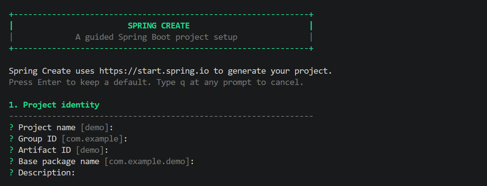
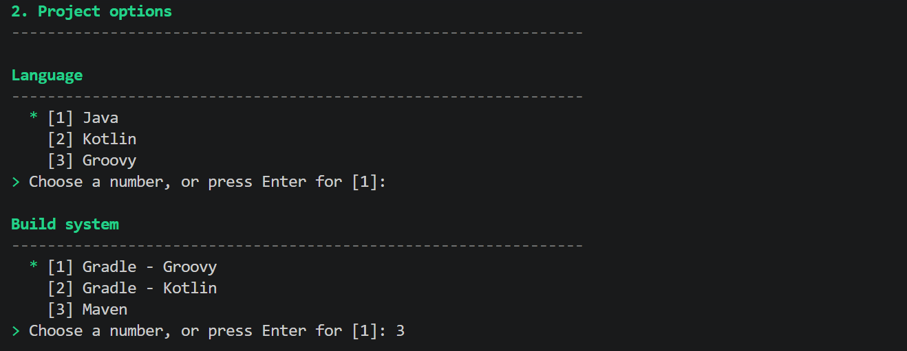
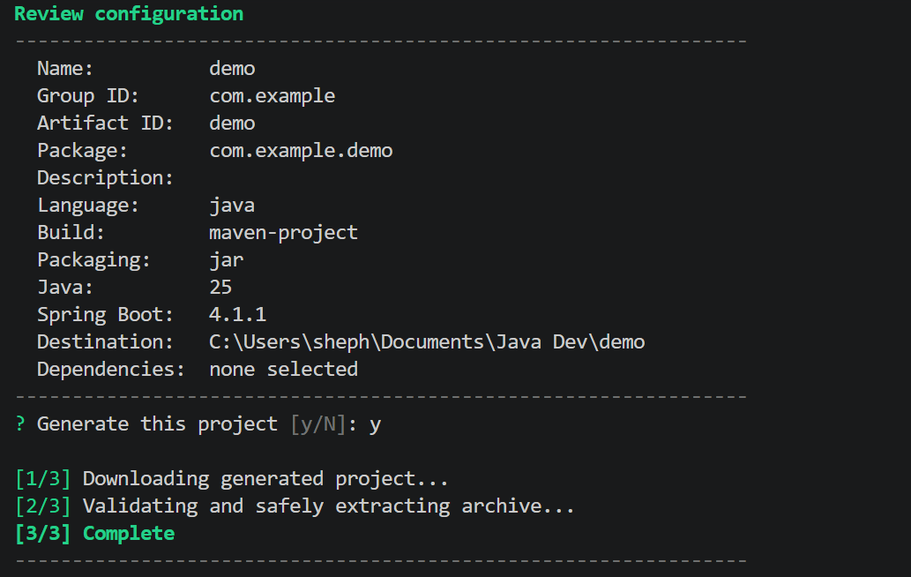

# spring-create

Create a production-ready Spring Boot project from the terminal in a few guided steps.

`spring-create` fetches current project metadata from the official [Spring Initializr](https://start.spring.io) service, lets you select supported project options and dependencies, previews the result, and downloads the generated project only after confirmation. It has no third-party Go dependencies and does not require Java, Maven, Gradle, Node.js, or a package manager to run.

```text
+--------------------------------------------------------------+
|                        SPRING CREATE                         |
|             A guided Spring Boot project setup               |
+--------------------------------------------------------------+
```

## Preview

The line-based wizard keeps the setup flow readable while providing optional green terminal accents.







## Features

- Current Spring Boot, Java, build-system, packaging, language, and dependency options come directly from Spring Initializr.
- A guided, colored terminal interface works in Windows Terminal, PowerShell, macOS Terminal, and Linux terminals.
- Plain-text output is retained for redirected logs. Use `--no-color` or `NO_COLOR=1` to disable ANSI colors.
- Downloads are size-limited and validated as ZIP archives before extraction.
- Extraction uses a staging directory and rejects traversal paths, absolute paths, Windows drive paths, symlinks, duplicate entries, and existing destinations.
- The generated project is never executed automatically.

## Install From Releases

Download the matching binary from this repository's **Releases** page. Go is not required when using a release binary.

| Platform | Architecture | Release asset |
| --- | --- | --- |
| Windows | x86-64 | `spring-create_<version>_windows_amd64.zip` |
| Linux | x86-64 | `spring-create_<version>_linux_amd64.tar.gz` |
| Linux | arm64 | `spring-create_<version>_linux_arm64.tar.gz` |
| macOS on Apple Silicon | arm64 | `spring-create_<version>_darwin_arm64.tar.gz` |
| macOS on Intel | amd64 | `spring-create_<version>_darwin_amd64.tar.gz` |

After installation, open a new terminal and confirm the command is available:

```text
spring-create --version
spring-create --help
```

### Windows

1. Download `spring-create_<version>_windows_amd64.zip` from Releases.
2. Extract it, then create a permanent user-level executable directory and move the binary into it:

```powershell
Expand-Archive "$HOME\Downloads\spring-create_<version>_windows_amd64.zip" "$HOME\Downloads\spring-create-release"
New-Item -ItemType Directory -Force "$HOME\bin"
Move-Item "$HOME\Downloads\spring-create-release\spring-create.exe" "$HOME\bin\spring-create.exe"
```

3. Add that directory to your user `PATH` once:

```powershell
$bin = "$HOME\bin"
$path = [Environment]::GetEnvironmentVariable("Path", "User")
if (($path -split ";") -notcontains $bin) {
    [Environment]::SetEnvironmentVariable("Path", "$path;$bin", "User")
}
```

4. Close and reopen PowerShell or Windows Terminal, then run:

```powershell
spring-create
```

### macOS

1. Download the Apple Silicon (`darwin_arm64`) or Intel (`darwin_amd64`) archive from Releases.
2. Install it to a user-local binary directory:

```sh
mkdir -p "$HOME/.local/bin"
tar -xzf "$HOME/Downloads/spring-create_<version>_darwin_arm64.tar.gz" -C "$HOME/.local/bin"
chmod +x "$HOME/.local/bin/spring-create"
```

3. Add the directory to `PATH`. macOS uses zsh by default:

```sh
echo 'export PATH="$HOME/.local/bin:$PATH"' >> "$HOME/.zshrc"
source "$HOME/.zshrc"
```

For bash, use `~/.bashrc` instead of `~/.zshrc`. Then run:

```sh
spring-create
```

### Linux

1. Download the x86-64 (`linux_amd64`) or ARM64 (`linux_arm64`) archive from Releases.
2. Install it to a user-local binary directory:

```sh
mkdir -p "$HOME/.local/bin"
tar -xzf "$HOME/Downloads/spring-create_<version>_linux_amd64.tar.gz" -C "$HOME/.local/bin"
chmod +x "$HOME/.local/bin/spring-create"
```

3. Add the directory to your shell startup file:

```sh
echo 'export PATH="$HOME/.local/bin:$PATH"' >> "$HOME/.bashrc"
source "$HOME/.bashrc"
```

For zsh, use `~/.zshrc`. Then run:

```sh
spring-create
```

## Use

Start the wizard with no arguments:

```sh
spring-create
```

Press Enter to accept a shown default. Enter comma-separated numbers for multi-select lists. Type `q` or `quit` at any prompt to cancel. Ctrl+C also cancels safely.

```text
--help, -h       Print usage
--version        Print the compiled version
--url URL        Use another compatible Initializr service
--output DIR     Set the default output parent directory
--no-color       Disable ANSI color output
--verbose        Print diagnostic context to stderr
```

Examples:

```sh
spring-create --output "$HOME/projects"
spring-create --no-color
spring-create --url http://localhost:8080
```

## Build From Source

Building requires only the current stable [Go SDK](https://go.dev/dl/). Clone or download this repository, then run the commands for your platform from the repository root.

### Windows PowerShell

```powershell
gofmt -w .
go test ./...
go vet ./...
New-Item -ItemType Directory -Force .\dist
$env:CGO_ENABLED = "0"
go build -trimpath -ldflags "-s -w -X main.version=0.1.0" -o .\dist\spring-create.exe .\cmd\spring-create
.\dist\spring-create.exe --version
```

### macOS and Linux

```sh
gofmt -w .
go test ./...
go vet ./...
mkdir -p dist
CGO_ENABLED=0 go build -trimpath -ldflags "-s -w -X main.version=0.1.0" -o ./dist/spring-create ./cmd/spring-create
./dist/spring-create --version
```

To make a locally built binary available as `spring-create`, use the same `PATH` installation steps from the release instructions above.

### Cross-Compile Release Binaries

Run these commands from any machine with Go installed:

```sh
mkdir -p dist
CGO_ENABLED=0 GOOS=windows GOARCH=amd64 go build -trimpath -ldflags "-s -w -X main.version=0.1.0" -o ./dist/spring-create.exe ./cmd/spring-create
CGO_ENABLED=0 GOOS=linux GOARCH=amd64 go build -trimpath -ldflags "-s -w -X main.version=0.1.0" -o ./dist/spring-create-linux-amd64 ./cmd/spring-create
CGO_ENABLED=0 GOOS=darwin GOARCH=arm64 go build -trimpath -ldflags "-s -w -X main.version=0.1.0" -o ./dist/spring-create-darwin-arm64 ./cmd/spring-create
CGO_ENABLED=0 GOOS=darwin GOARCH=amd64 go build -trimpath -ldflags "-s -w -X main.version=0.1.0" -o ./dist/spring-create-darwin-amd64 ./cmd/spring-create
```

## Security Model

The CLI uses HTTPS by default, standard TLS verification, network timeouts, a 100 MiB download cap, and a 250 MiB uncompressed extraction cap. Remote ZIP content is treated as untrusted. It is extracted into a temporary staging directory and moved into place only after successful validation and extraction.

The generated Spring application has separate requirements: install a compatible JDK and use its generated Maven or Gradle wrapper to build or run it.

## Troubleshooting

- `spring-create: command not found` or `spring-create is not recognized`: open a new terminal and verify the directory containing the binary is listed in `PATH`.
- `go` is not recognized: reopen the terminal after installing Go. If it persists, check `PATH` or reinstall the official Go SDK.
- Network, proxy, or TLS errors: verify internet access and proxy settings. Use `--url` for a compatible local or custom Initializr instance.
- Initializr metadata errors: the remote service may be unavailable or have changed its response. The CLI deliberately does not fall back to stale hardcoded values.
- Destination already exists: choose a different output directory or artifact ID. Existing user files are never overwritten.
